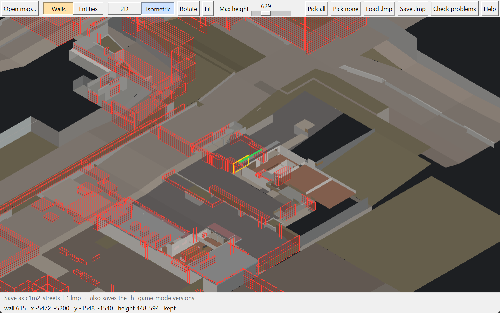
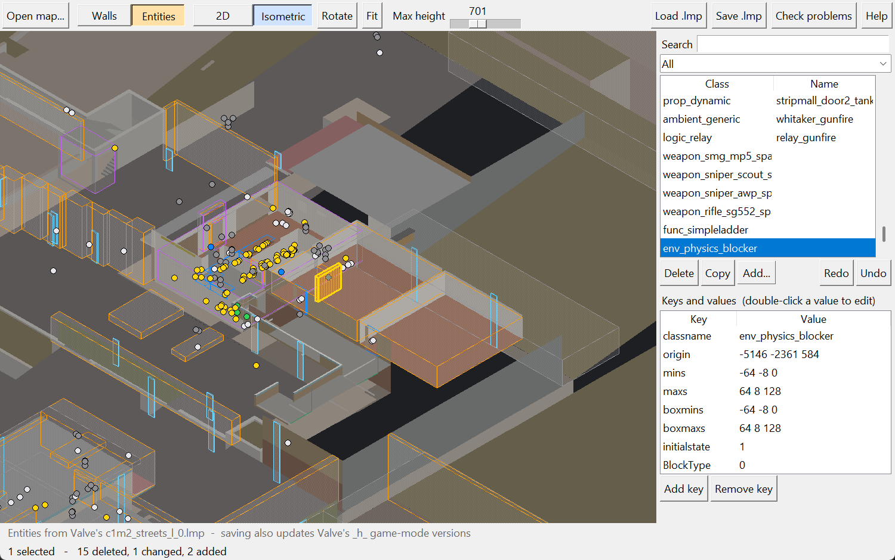
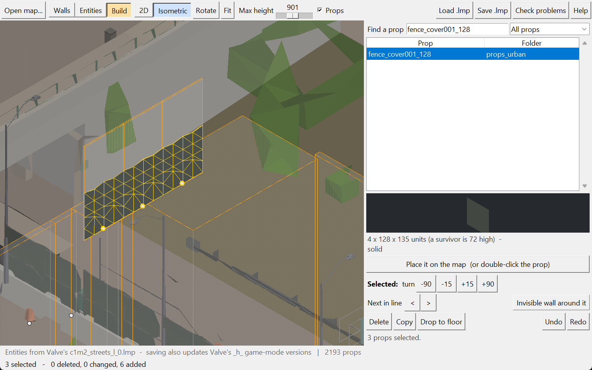

# L4D2 Map Editor

Remove invisible walls and edit doors, ladders, blockers, props and triggers on any Left 4 Dead 2 map, official or custom, **without Hammer and without recompiling**. Your changes are saved as a small `.lmp` patch that you ship in an addon; the original map is never touched.

Made by **Rune**. Free and open source: use it, change it, share it. Please credit Rune if you pass it on.



## Download

Get it from **[Releases](../../releases/latest)**:

- **`L4D2.Map.Editor.exe`**: double-click and go, nothing to install (Windows only).
- **`L4D2.Map.Editor.by.Rune.zip`**: the Python version and the full 18-page guide (FAQ and troubleshooting included).

Windows may say "Windows protected your PC" because the .exe isn't signed by a company: click **More info**, then **Run anyway**. If your antivirus complains, use the Python version: it's the same tool.

## Python version

`L4D2_Map_Editor.py` needs [Python 3.8 or newer](https://www.python.org/downloads/) (tick **Add Python to PATH** when installing), nothing else. Open a command prompt in its folder and run:

```
python L4D2_Map_Editor.py
```

If `python` isn't recognized, try `py L4D2_Map_Editor.py`.

## What it does

- **Opens any map:** official `.bsp` files, or custom/Workshop maps straight from their addon `.vpk`.
- **2D and isometric views:** a colored 3D render of the map, rotate, zoom, and a height slider to cut away roofs.
- **Walls mode:** click invisible walls (player clip) to remove them.
- **Entities mode:** delete, move, copy and edit entities (doors, ladders, blockers, props, triggers, logic), add new invisible walls or props, undo/redo.
- **Build mode (new in 1.1):** browse the game's ~5,000 props (fences, walls, crates, cars...) with a 3D preview, place them where you click, turn them, line them up into a fence, drop them to the floor, and put an invisible wall around them so nobody squeezes through.
- **Props drawn for real (new in 1.1):** every prop, including the ones built into the map, is drawn with its real shape and colors, read from the game's own model files. Small or far-away props are simplified, so it stays smooth.
- **Saves `.lmp` patches** that keep Valve's own fixes, pick the right file numbers, and also cover Valve's game-mode versions of the patch.
- **Check problems:** scans your addons and patches for about 20 kinds of problems (addon turned off, file never loads, typo in the map name, two patches cancelling each other, broken files...) and fixes most of them automatically, with backups.





## How it works

A `.lmp` file replaces one part ("lump") of a map when it loads. Walls mode writes the brushes lump (18) with the player-clip flag cleared on the walls you pick; Entities and Build modes write the entity lump (0). Build mode adds `prop_dynamic` entities using the game's own models (the same way Valve added fences and plywood to its maps in The Last Stand update) and `env_physics_blocker` walls; it can't create new map geometry. Valve fixes its own maps the same way (see `update/maps/` in your game folder). Tested in game: a patch saved by this tool, shipped in an addon, is loaded over Valve's own patch in co-op and versus.

The full technical details are in the guide.

## Command line

```
python L4D2_Map_Editor.py check
python L4D2_Map_Editor.py <map>.bsp write <map>_l_1.lmp all
python L4D2_Map_Editor.py <map>.bsp list X0 Y0 X1 Y1
```

## License

Free to use, change and share. Please credit Rune if you share it.
